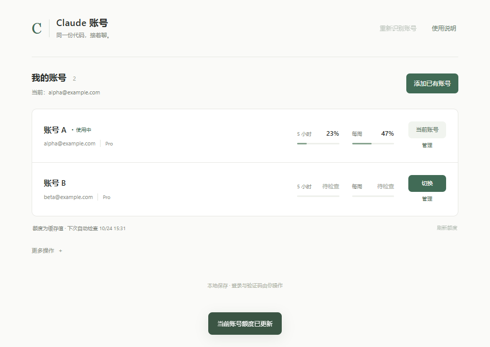

# Claude Account Workbench

A Chinese-language Windows desktop workbench for saved Claude accounts, usage checks, Chrome profile bindings, and continuity of local Claude Code conversations.

[中文文档](README.md) · [Downloads](https://github.com/kkx9578/claude-account-workbench/releases) · [Changelog](CHANGELOG.md) · [Contributing](CONTRIBUTING.md) · [Security](SECURITY.md)



## Requirements

- Windows x64; validated on Windows 11. No macOS, Linux, or native Windows ARM release is provided.
- The official Claude desktop application and the system Microsoft Edge WebView2 Runtime.
- Google Chrome for the guided login and profile-binding flow.
- An account entitled to use Claude Code, such as a supported Pro plan. Entitlements follow Anthropic's current terms. Opening the desktop Code page may be necessary to complete its initial authorization after signing in to regular chat.

## Get started

1. Download the Windows ZIP or `claude-account-workbench-windows-amd64.exe` from [Releases](https://github.com/kkx9578/claude-account-workbench/releases).
2. Exit any older account manager from its tray menu. Keep your Claude account signed in.
3. Start the workbench. Sign in through the official Claude application and complete Code authorization if needed.
4. Click **重新识别账号** to refresh the current identity, then **刷新额度** to fetch current usage.
5. Open an account's **管理** controls to bind its Chrome profile.

To add another existing account, use **添加已有账号**. The workbench saves the current login before opening the same Claude application's login screen. Enter passwords and verification codes only in official pages, then return to compare the detected email with the expected email.

Each Chrome profile can be bound to one account. Opening it does not change the Windows default browser; move a login link to the selected profile manually if necessary. The easyAI launcher is optional and does not configure or verify networking.

## Switching and refresh behavior

Save your work and stop running tasks before switching accounts or syncing chats: these operations restart Claude. Saved Code conversation IDs, local transcripts, and project directories remain in use; the workbench synchronizes local session indexes and project groupings.

Identity and usage refreshes are separate, affect only the current account, and do not themselves restart Claude. Both bypass the ordinary polling schedule and have independent 15-second repeat guards. A newly identified account may require a separate, explicitly confirmed chat sync.

Automatic usage checks normally run every 15 minutes for the current account and every 30 minutes for others. HTTP 429 responses pause checks for at least 30 minutes, increasing to 60 and 120 minutes on repeated limits; a longer server-requested delay takes precedence. These delays survive restarts. A result that could not be saved leaves checks paused rather than silently retrying.

The displayed percentages are cached usage, not remaining allowance. A missing cache is shown as pending.

## Data and limits

Manager data lives in `%USERPROFILE%\.claude-account-switcher`. Login snapshots, backups, raw configuration, cookies, and tokens are sensitive. Do not attach them to public issues or commit them. Use [private vulnerability reporting](https://github.com/kkx9578/claude-account-workbench/security/advisories/new) for security problems.

Continuity covers local Code session indexes on the same computer. Ordinary cloud chats, Cowork sessions, and running tasks are outside the guarantee. Profile bindings do not provide separate operating systems or IP addresses and cannot guarantee that an account will avoid platform restrictions.

## Build

Use Go 1.26.9 on Windows x64:

```powershell
go vet ./...
go test -count=1 ./...
go build -tags production -trimpath -ldflags "-H=windowsgui -s -w" -o claude-account-workbench-windows-amd64.exe .
```

The resulting application requires the system WebView2 Runtime.

## Origin and license

Based on [SnlperStripes/claude-account-switcher v0.3.1](https://github.com/SnlperStripes/claude-account-switcher/releases/tag/v0.3.1), licensed under Apache-2.0. See [LICENSE](LICENSE), [NOTICE](NOTICE), and [dependency licenses](THIRD_PARTY_LICENSES/README.md).

The first public version, **v0.1.0**, corresponds to the earlier local UI edition 2.2 and starts an independent version sequence. It does not claim to include every compatibility fix from upstream v0.3.2 or later. Future Claude storage or API changes may require adaptation. This project is not affiliated with Anthropic.
